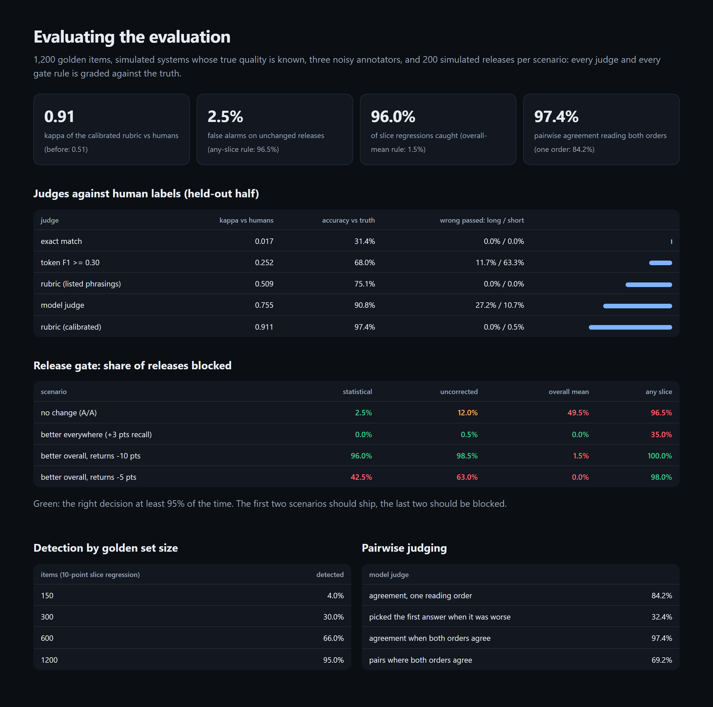

# LLM Evaluation Platform

Evaluation for LLM systems that holds up. It covers golden sets, judges calibrated against human
labels before anyone trusts them, pairwise judging with position bias removed, paired statistics,
and a release gate that checks every slice. The gate's false-alarm rate and power are measured on
releases whose true effect is known. In short, this is the evaluation of the evaluation.

[](https://github.com/codeROCK-IZZY/llm-evaluation-platform/actions/workflows/ci.yml)



## Results

From `evalp evaluate` (1,200 golden items in 5 slices, 200 simulated releases per scenario;
[full report](eval/reports/evaluation.md)). Every answer's true quality is known by construction
([ADR 1](docs/adr/0001-ground-truth-by-construction.md)).

**Judges, scored against three annotators on a held-out half:**

| judge | kappa vs humans | accuracy vs truth |
|---|---:|---:|
| exact match | 0.02 | 31% |
| token F1 (threshold tuned) | 0.25 | 68% |
| rubric, listed phrasings only | 0.51 | 75% |
| model judge (noise, length bias) | 0.76 | 91%; passes 27% of long wrong answers |
| **rubric, calibrated** | **0.91** | **97%** |

The calibrated rubric learned 9 phrasing templates from answers the annotators passed and the rubric
failed, using the calibration half only. The annotators agree with each other at a Fleiss kappa of
0.68, so the calibrated rubric agrees with their majority better than they agree with each other.

**Pairwise judging:** read in one order, the model judge agrees with humans 84% of the time. Read in
both orders, with a verdict only when they agree, agreement rises to **97%**. Both orders agree on
69% of pairs; the rest are ties.

**The release gate** (share of releases blocked):

| scenario | **statistical (this)** | uncorrected | overall mean | any slice drops |
|---|---:|---:|---:|---:|
| no change (should ship) | **2.5%** | 12.0% | 49.5% | 96.5% |
| better everywhere (should ship) | **0.0%** | 0.5% | 0.0% | 35.0% |
| better overall, one slice -10 pts (should block) | **96.0%** | 98.5% | 1.5% | 100% |
| better overall, one slice -5 pts (should block) | 42.5% | 63.0% | 0.0% | 98.0% |

The overall-mean gate ships a release that breaks one slice 98.5% of the time. The any-slice gate
blocks 96.5% of unchanged releases. The statistical gate keeps false alarms under 5% and catches 96%
of 10-point slice regressions. It still misses most 5-point ones; the sampled release in the report is
one it missed.

**Power by golden set size** (10-point regression in one of five slices): 150 items 4%, 300 items
30%, 600 items 66%, **1,200 items 95%**. The golden set is sized from this curve, not from habit.

## How it works

- `golden.py`: support questions in five slices. Each has the facts a correct answer must state, the
  phrasings a rubric lists, a paraphrase it doesn't, and the wrong version of each fact.
- `systems.py`: simulated versions of the assistant with known per-slice quality. Each answer states a
  fact correctly, wrongly or not at all, so every answer carries its true label.
- `judges.py`: exact match, token F1, the rubric and its calibration (`Rubric.learn`), a model judge
  with documented biases, three annotators with their own error rates, Cohen's and Fleiss' kappa.
- `stats.py`: paired bootstrap confidence intervals, the exact McNemar test, Holm-Bonferroni.
- `gate.py`: block when the whole set or any slice is worse by more than 2 points *and* the
  Holm-adjusted p-value is below 0.05 ([ADR 2](docs/adr/0002-slice-gate-with-holm.md)).

## Run it

```bash
python -m venv .venv && . .venv/bin/activate
pip install -e ".[dev]"
pytest
evalp evaluate --gate                                 # writes eval/reports/{evaluation.md,evaluation.json,report.html}
evalp compare                                         # baseline vs a resampled baseline: ship (exit 0)
evalp compare --slice returns --slice-recall 0.75     # a slice regression: blocked (exit 1)
```

`evalp compare` first calibrates the rubric on a separate annotator-labelled set, then grades both
releases with it and prints each slice with its confidence interval and adjusted p-value. On
unchanged releases it blocks about 2.5% of the time, as measured above.

| check | where |
|---|---|
| 10 tests, strict mypy, ruff | `tests/`, `src/` |
| the evaluation as a CI gate (kappa ≥ 0.8, false alarms ≤ 5%, power ≥ 80%, debiasing helps) | `.github/workflows/ci.yml` |
| the CLI exits 1 on a slice regression | `.github/workflows/ci.yml` |

See [known limitations](docs/known-limitations.md).

## License

MIT
